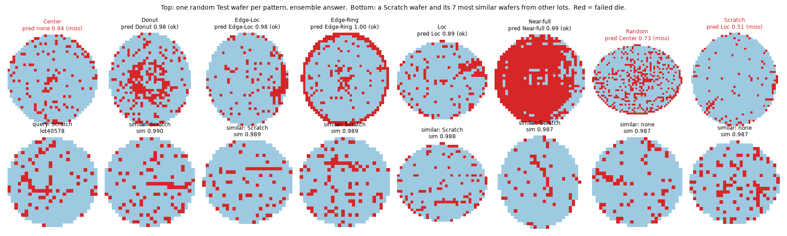
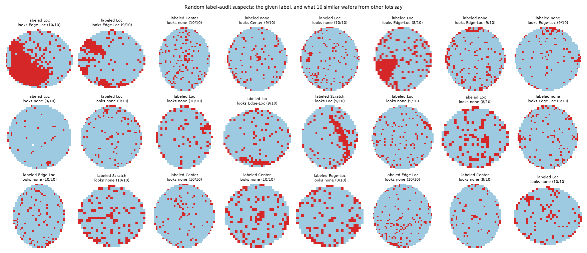
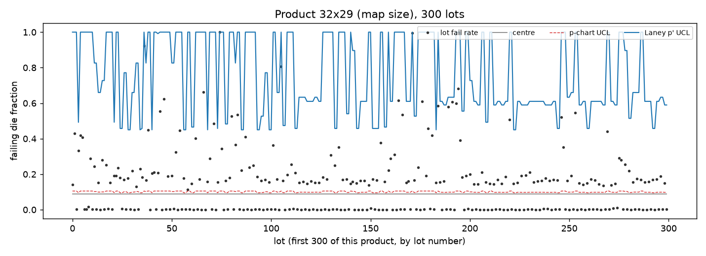
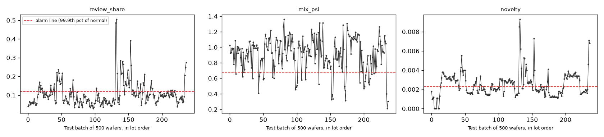

# Wafer Yield: from a failed-die map to an action, on 811K real wafers

**Live demo:** https://navyathag13-ui.github.io/wafer-yield/ (real Test wafers, no install)

A chip fab tests every die on a wafer and marks it pass or fail. Drawn as a map, the fails
often form a shape (a ring at the edge, a blob in the centre, a thin scratch). Each shape
points to a different process or tool problem. This project takes the public **WM-811K**
dataset (811,457 wafer maps from real fab production, Wu et al. 2015) and follows one wafer
through the questions a yield engineer asks:

| Step | Question | What answers it |
|---|---|---|
| **1. Detect** | What pattern is on this wafer? | Feature trees + CNN ensemble, 99.0% accurate on the 89% of wafers it labels alone |
| **2. Explain** | What could cause it? Have we seen it before? | Defect guide with published sources, similar-wafer search (60% vs 26% for pixel matching) |
| **3. Trust** | When should a person look instead? | "Needs review" flag, label audit that found 504 likely wrong human labels |
| **4. Act** | Which lots need attention? | Per-product Laney p' charts that flag 4.2% of lots, not 96.6% |
| **5. Watch** | Is the model still seeing the wafers it was checked on? | Drift alarm that fired on 97% of Test batches and 9.6% of normal ones |

Every number below comes from `results/` and was produced by the scripts in this repo on the
full dataset.



*Randomly picked Test wafers, misses included (`scripts/examples.py`).*

## 0. Data: load it safely and check it

`scripts/run_pipeline.py` (36 to 86 s for the ETL on a laptop)

| | |
|---|---|
| Wafers read / loaded / quarantined | 811,457 / 811,457 / 0 |
| Labeled with a pattern | 172,950 (21%); Training 54,355, Test 118,595 |
| Lots | 46,293 (median 24 wafers) |
| Distinct map sizes | 632 |
| Parquet output | 144 MB (zstd), from a 2.1 GB pickle |

WM-811K ships as a Python 2 pandas pickle. A plain `pickle.load` runs any code a tampered
copy contains. `wafer_yield/source.py` allows only the numpy and pandas classes a DataFrame
needs and translates Python 2 names before checking. Tests confirm it blocks `os.system` and
`pandas.read_csv` payloads.

The checks (die codes only 0/1/2, at least one die, stored `dieSize` equal to the dies on the
map, wafer index 1 to 25, no duplicate lot and index) found nothing to quarantine. I confirmed
that with a separate script on the raw DataFrame rather than trusting a zero. The checks still
run on every load and are tested on bad inputs.

Yield by labeled pattern (mean die yield): Near-full 12%, Random 52%, Donut 72%, Center 77%,
Edge-Loc 82%, Edge-Ring 85%, Loc 85%, no pattern 89%, Scratch 90%.

## 1. Detect: what pattern is on this wafer?

All models train on 49,188 Training wafers. Another 5,167 wafers from whole lots held out of
Training pick every setting (best epoch, CNN variant, ensemble weight, review threshold).
Scores are on the official Test split: 118,595 wafers from lots never seen in training.

| Model | Accuracy | Macro F1 (9 classes) | Macro F1 (8 defects) |
|---|---|---|---|
| Gradient-boosted trees on 20 hand-made features (40 s, CPU) | 93.6% | 0.670 | 0.632 |
| CNN, 73K weights, 15 epochs (Apple MPS) | 95.5% | 0.678 | 0.640 |
| + averaged over 8 rotations and flips | 95.7% | 0.682 | 0.645 |
| + 56,332 pseudo-labels from unlabeled wafers | 95.8% | 0.695 | 0.659 |
| + both (chosen on validation) | **96.0%** | 0.702 | **0.667** |
| **Ensemble** (0.3 CNN + 0.7 trees) | 94.9% | **0.703** | 0.669 |

**Rotations and flips.** A scratch is still a scratch when the wafer is turned, so the CNN
scores each wafer 8 ways (4 rotations, each mirrored) and averages them. Scratch F1 rose from
0.557 to 0.598.

**Pseudo-labels.** 79% of WM-811K wafers have no label. The first CNN labeled a sample of
200,000 of them (none from validation or Test lots). Only answers with confidence 0.95
or more were kept, capped at 50,000 "none" and 3x each defect's labeled count. Retraining on
labeled + pseudo-labeled wafers lifted macro F1 from 0.678 to 0.695.

**The ensemble** now adds little macro F1 over the improved CNN (0.703 vs 0.702) and costs
accuracy. It stays because it misses fewer defects: defect wafers called "none" drop from
1,780 (CNN) to 1,193 of 7,894. The price is more false alarms on clean wafers (1,932 to 3,865
of 110,701). In a fab a missed defect usually costs more than a second look.

| Pattern | Trees | CNN (final) | Ensemble |
|---|---|---|---|
| Center | 0.45 | 0.51 | 0.50 |
| Donut | 0.66 | 0.60 | 0.69 |
| Edge-Loc | 0.58 | 0.67 | 0.62 |
| Edge-Ring | 0.76 | 0.78 | 0.80 |
| Loc | 0.50 | 0.55 | 0.55 |
| Near-full | 0.94 | 0.92 | 0.95 |
| Random | 0.70 | 0.71 | 0.71 |
| Scratch | 0.46 | 0.60 | 0.53 |
| none | 0.97 | 0.98 | 0.98 |

## 2. Explain: what could cause it? Have we seen it before?

**Defect guide** (`wafer_yield/defects.py`). Each pattern has a plain description and, where a
paper I read gives one, a possible cause with its source. The papers hedge, so these are leads
to check against tool and lot history, not diagnoses:

| Pattern | Possible cause | Source |
|---|---|---|
| Center | Abnormal liquid flow or liquid pressure | Geng et al., ASP-DAC 2023 |
| Donut | At one technology node: under-etched metal causing resistive vias | Hu, He and Li, ITC 2021 |
| Edge-Loc | Contamination during fabrication | Geng et al., ASP-DAC 2023 |
| Edge-Ring | At one technology node: poly CD running short near the edge | Hu, He and Li, ITC 2021 |
| Random | Particles such as dust | Geng et al., ASP-DAC 2023 |
| Scratch | Sharp edges touching and slipping on the surface during manufacturing or test | Hu, He and Li, ITC 2021 |
| Loc, Near-full | No cause given in the papers I checked, so none is shown | |

The API returns this guide with every `/classify` answer.

**Similar-wafer search** (`wafer_yield/similar.py`). Each wafer becomes 64 numbers from the
CNN's last layer. Search returns the closest past wafers by cosine similarity. Scored on
all 7,894 Test defect wafers searching the 49,188 Training wafers (always other lots): what
share of the 10 nearest wafers carry the same label?

| Pattern | CNN embedding | Plain pixel match |
|---|---|---|
| **All defects** | **59.9%** | 26.0% |
| Center | 57.0% | 19.3% |
| Donut | 53.6% | 14.1% |
| Edge-Loc | 65.8% | 31.7% |
| Edge-Ring | 71.6% | 71.7% |
| Loc | 47.9% | 4.1% |
| Near-full | 79.3% | 100% |
| Random | 65.0% | 0.7% |
| Scratch | 51.7% | 0.6% |

Pixel matching only works when the defect sits in the same place (an edge ring, an almost
fully failed wafer). Scratches and random fails at different spots look nothing alike pixel by
pixel, while the embedding still finds them.

## 3. Trust: when should a person look instead?

**"Needs review" flag.** When the ensemble's top probability is below 0.798 (set on
validation to send 5% of wafers to review), the wafer goes to an engineer:

| Confidence cut-off | Wafers sent to review | Accuracy on the rest | Macro F1 on the rest |
|---|---|---|---|
| none (label everything) | 0% | 94.9% | 0.703 |
| 0.6 | 4.0% | 96.7% | 0.768 |
| **0.798 (chosen on validation)** | **10.6%** | **99.0%** | **0.890** |
| 0.9 | 15.3% | 99.5% | 0.923 |

On Test it sends 10.6% instead of 5% because the Test lots differ from Training (step 5
measures that). Confidence is not a full safety net: some wrong answers are confident.

**Label audit** (`scripts/audit.py`). People labeled WM-811K, so some labels are wrong. A
wrong label makes a correct model look wrong. A wafer is a suspect when at least 8 of its 10
most similar labeled wafers from other lots agree on a different label and the ensemble also
gives that label at least 0.8.

- **504 suspects (0.29% of 172,950 labeled wafers).** 486 are in Test, 11 in validation and
  only 7 in the training wafers, which is expected since the model learned those labels.
- Most common: labeled Loc but looks none (143), Center to none (88), Edge-Loc to none (80),
  none to Edge-Loc (50).
- I looked at 24 random suspects myself (not as a fab expert): 15 look mislabeled, 3 look
  correctly labeled and 6 are unclear.
- Test macro F1 is 0.703 with every wafer and 0.718 without the suspects. That second number
  is an upper bound, not a corrected score, because the model agrees with the suggested labels.



## 4. Act: which lots need attention?

`wafer_yield/spc.py` builds a fail-rate table per lot and charts it per product (here, per
map size) with p-charts and Laney p' charts.

| Setup | Lots flagged by p-chart | Laney sigma_z | Lots flagged by Laney p' | Run-rule hits |
|---|---|---|---|---|
| One chart for every product | 96.6% | 31.3 | 5.2% | 18,286 |
| One chart per product (202 products, 44,221 lots) | 83.2% | 11.1 (median) | **4.2% (1,861 lots)** | 6,209 |

435 of the 1,861 flagged lots also contain labeled defect wafers, so the alarm comes with a
pattern (and a guide entry) attached. The demo lists the worst of them.



## 5. Watch: is the model still seeing the wafers it was checked on?

The scores above only hold for wafers like the ones the model was validated on.
`wafer_yield/drift.py` checks every batch of 500 wafers with three numbers:

- **review_share:** share of wafers the ensemble is unsure about
- **mix_psi:** population stability index of the predicted pattern mix against validation
- **novelty:** median distance from each wafer to its closest training wafer in the CNN embedding

Alarm lines are the 99.9th percentile of each number over batches built from whole validation
lots. False alarms are measured with 5-fold cross-validation over validation lots.

| | Batches | Alarmed |
|---|---|---|
| Normal batches (held-out validation lots) | 500 | **9.6%** |
| Test split streamed in lot order | 237 | **229 (96.6%)** |

The Test split is 93% clean wafers against 68% in Training and holds 8,263 wafers from map
sizes Training never saw. The alarm catches that: the pattern mix fired on 202 batches,
novelty on 118 and review share on 59. In a fab this is the signal to recheck the model
before trusting its labels.



## 6. Serve: run it on Azure and load-test it

The API runs in a Docker container (CPU PyTorch, non-root) on Azure Container Apps. Terraform
in `infra/` creates the registry, logs, environment, the app with health probes and HTTP
autoscaling (1 to 5 replicas, one more per 10 requests in flight) and a $10 budget alert.
`infra/cloudshell_deploy.sh` builds the image inside Azure and applies it from Cloud Shell;
`infra/cloudshell_destroy.sh` removes it all.

I deployed it on 2026-11-26, ran `scripts/load_test.py` against it from my laptop (70%
classify, 20% similar, 10% SPC calls, 30 seconds per level) and then destroyed it:

| In flight | Requests/s | p50 | p95 | p99 | Errors |
|---|---|---|---|---|---|
| 1 | 17.6 | 49 ms | 94 ms | 130 ms | 0 |
| 5 | 72.3 | 54 ms | 98 ms | 125 ms | 0 |
| 10 | 147.9 | 54 ms | 104 ms | 165 ms | 0 |
| 20 | 255.4 | 68 ms | 153 ms | 210 ms | 0 |
| 40 | 284.9 | 113 ms | 343 ms | 431 ms | 0 |

23,464 requests, 0 errors. Azure scaled the app from 1 to 5 replicas during the run. The same
test on one laptop CPU peaked at 16.9 requests/s with a p95 of 844 ms at 10 in flight
(`results/load_test_local_1cpu.json`), so one replica is the limit and scaling out is what
carries the load. At 40 in flight all 5 replicas are busy and latency starts to climb.
Raw numbers: `results/load_test_azure_container_apps.json`.

## What went wrong and what I changed

- **My first validation split leaked.** I held out random wafers from Training to pick the best
  epoch. Wafers from one lot share their defect, so the same lots sat on both sides: validation
  said 0.937 macro F1 while Test said 0.675 (`results/metrics_random_wafer_validation.json`).
  Validation now holds out whole lots, as the official split does.
- **The first drift alarm cried wolf.** Calibrated on batches of random single wafers, it fired
  on 61% of normal held-out batches. Wafers arrive by lot and lots differ from each other, so
  random wafers hide that spread. Building batches from whole lots cut it to 21%, and
  cross-validated 99.9th percentile lines cut it to 9.6%.
- **Pseudo-labeling first ran out of memory.** Loading 600,000 unlabeled maps row by row pushed
  the laptop into 23 GB of swap. Sampling 200,000 wafers into a preallocated array brought it
  down to about 1 GB.
- **Diagonal scratches were invisible to the cluster features.** 4-connectivity split a
  diagonal scratch into single dies. A synthetic-scratch test caught it; clusters now use
  8-connectivity.
- **One SPC chart across all products measured product mix, not process.** It flagged 96.6% of
  lots. Charting each product separately cut run-rule hits from 18,286 to 6,209.
- **Plain p-chart limits are too tight for fab lots.** Even per product they flagged 83% of
  lots. Laney's p' measured the extra lot-to-lot spread (sigma_z 11) and left 4.2% flagged.
- **A fix that did not move the number.** A fail-keeping max-pool resize (so a one-die scratch
  survives shrinking to 64 x 64) left CNN Scratch F1 at 0.557. Only 2% of maps are larger than
  64 on a side. It stays because it is correct. Rotation averaging is what lifted Scratch.
- **Citations.** I first attached a defect cause to a paper I could not read in full. I removed
  it and kept only causes I found in papers I read, with authors checked against the DOI record.

## Limits

- Map size stands in for "product", so it is a rough product ID.
- Lots have names, not timestamps. Lot order shows how the run rule and drift stream work, but
  it is not proof of change over time.
- Center, Loc and Scratch stay the weakest classes (ensemble F1 0.50 to 0.55). Most misses are
  called "none". Some are confident, so the review flag does not catch them.
- Label-audit suspects are leads, not proven errors. My review of them is a non-expert one.
- The defect causes are from published papers about other fabs and nodes; real root cause
  needs tool and lot history this dataset does not have.

## Run it

```bash
python3.11 -m venv .venv && .venv/bin/pip install -r requirements.txt
# LSWMD.pkl from kaggle.com/datasets/qingyi/wm811k-wafer-map (CC0, 2.1 GB, sign-in needed)
.venv/bin/python scripts/run_pipeline.py ~/Downloads/LSWMD.pkl   # 0. data + 4. SPC
.venv/bin/python scripts/train.py --epochs 15                    # 1. detect, 2. similar, 3. review
.venv/bin/python scripts/audit.py                                # 3. label audit + 5. drift
.venv/bin/python scripts/build_demo.py                           # static demo in docs/
.venv/bin/uvicorn wafer_yield.api:app
```

API:

- `POST /classify` takes a map (`{"wafer_map": [[0,1,2,...], ...]}`) and returns the pattern, confidence, `needs_review`, top 3, die yield and the guide entry with sources.
- `POST /similar` takes a map and `k` and returns the k most similar labeled wafers.
- `GET /similar/{lot}/{wafer_index}` does the same for a known wafer, skipping its own lot.
- `GET /lots/{lot}` returns a lot's yield, limits and status.
- `GET /spc/signals` lists lots outside the Laney limits, worst first.

Bad maps return 422 with the reason (for example `unknown die codes [3]`).

## Tests

`pytest -q`: 32 tests, all on synthetic wafers (`tests/synthetic.py`), so CI never needs the
2 GB file. They cover the checks and quarantine counts, the features on known shapes, p-chart
and Laney math, the run rule, the safe loader, the fail-keeping resize, similarity ranking,
PSI and the drift monitor, the defect guide and every API endpoint. GitHub Actions runs them
on every push.

## Layout

```
wafer_yield/source.py    safe loader for the pickle
wafer_yield/etl.py       checks, quarantine, Parquet
wafer_yield/features.py  20 features: rings, sectors, fail clusters
wafer_yield/maps.py      die codes, nearest and fail-keeping resize
wafer_yield/cnn.py       CNN, augmentation, rotation averaging, embeddings
wafer_yield/similar.py   cosine search over embeddings, precision@k
wafer_yield/defects.py   defect guide and sources
wafer_yield/spc.py       lot table, p and Laney p' charts per product, run rule
wafer_yield/drift.py     drift monitor: review share, PSI, novelty
wafer_yield/api.py       FastAPI service
scripts/                 run_pipeline.py, train.py, audit.py, build_demo.py, examples.py
docs/                    static demo for GitHub Pages
results/                 metrics, charts, logs, trained models, embeddings
```

## Sources

- Data: Wu, Jang and Chen, "Wafer Map Failure Pattern Recognition and Similarity Ranking for Large-Scale Data Sets," IEEE Transactions on Semiconductor Manufacturing 28, 2015. [doi:10.1109/TSM.2014.2364237](https://doi.org/10.1109/TSM.2014.2364237)
- Geng, Sun, Chen, Xu, Ho and Yu, "Mixed-Type Wafer Failure Pattern Recognition," ASP-DAC 2023. [PDF](http://www.cse.cuhk.edu.hk/~byu/papers/C154-ASPDAC2023-Mixwafer.pdf)
- Hu, He and Li, "Semi-supervised Wafer Map Pattern Recognition using Domain-Specific Data Augmentation and Contrastive Learning," IEEE ITC 2021. [doi:10.1109/ITC50571.2021.00019](https://doi.org/10.1109/ITC50571.2021.00019)
